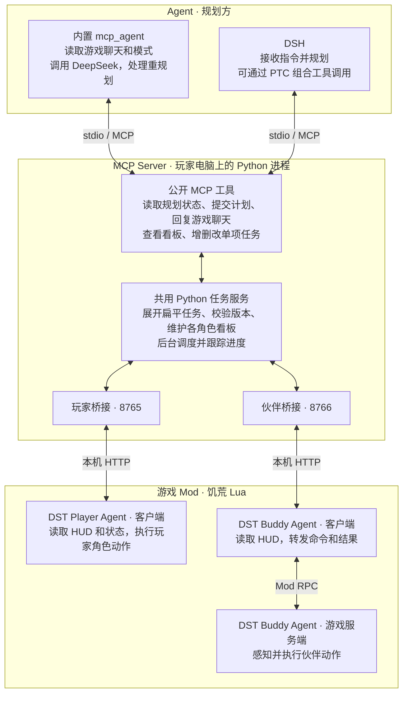

# 系统架构

玩家版和伙伴版各自启动一个 MCP 服务进程，共用任务服务的实现。图中的两个桥接节点表示两种部署入口。每个受控角色维护自己的看板和任务进度。伙伴版只召唤一人时也使用队伍协议。

## 一次内置指令

1. 玩家在游戏 UI 切换模式或在聊天框发送指令。Lua 将控制状态和游戏快照发给本机 MCP Server。
2. `mcp_agent` 调用 `get_planning_state`，读取指令、看板、复核原因和版本，再交给 DeepSeek 规划。
3. Agent 调用 `submit_task_board` 并携带读取到的版本。MCP Server 校验、更新看板，并持续调度。Lua 接收并执行具体动作。
4. Agent 读取最新进度，通过 `send_planning_reply` 在游戏里回复。自主模式继续规划阶段目标，指令模式确认完成后等待下一条指令。

DSH 使用同一套 MCP 工具，也可用 `submit_task` 新增单项任务。游戏动作和看板工具详见 [MCP 接口](MCP.md)。

## 架构决策：为什么玩家版坚持客户端 Mod

- **定位差异**：`DST Player Agent`（玩家版）不仅是自动化游玩工具，更是面向大模型的 **《饥荒联机版》智能体评测集 / Benchmark**；`DST Buddy Agent`（伙伴版）则定位为面向真实玩家的联机 AI 队友。
- **保留战争迷雾与局部视野**：作为评测基准，智能体必须与人类玩家处于完全公平的信息边界——仅能感知客户端 `ThePlayer` 视野与已探索地图/记忆，**不得**通过服务端 `TheWorld` 上帝视角提前获知未探索地形、资源分布或隐藏实体。
- **保留客户端网络延迟与真实同步**：角色操控必须经由真实客户端 `playercontroller`、`SendRPCToServer` 和 `replica` 复制链路，真实保留网络往返延迟、移动预测/回滚、背包同步与动作打断等实机约束。
- **零服务端侵入**：客户端 Mod 无需服主开启任何服务端插件，可在任意标准房间或本地无头服中运行。
- **自动化测试策略（不以牺牲真实性换取测试便利）**：
  - 玩家版不迁移至服务端，而是通过 `python/tools/client_e2e_sandbox.py` 拉起**静音小窗隔离真客户端**连接本地 `-offline` 无头服，在保留完整客户端延迟、迷雾与 RPC 链路的前提下完成自动化 E2E 回归与基准评测。
  - 伙伴版因本身需在服务端生成并控制独立 NPC，保留服务端 Mod 形态，并通过 `python/tools/headless_sandbox.py`（Klei 官方 `nullrenderer`）进行高速无头实机回归。
