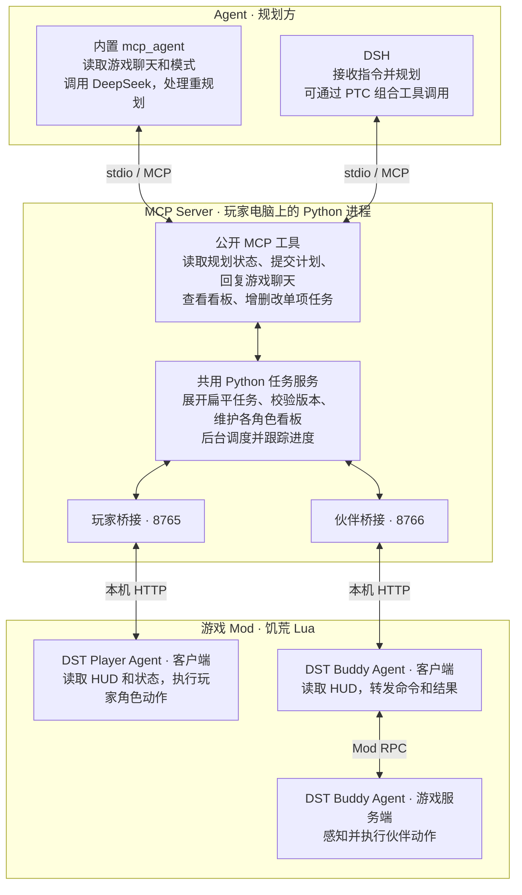

# 系统架构

玩家版和伙伴版各自启动一个 MCP 服务进程，共用任务服务的实现。图中的两个桥接节点表示两种部署入口。每个受控角色维护自己的看板和任务进度。伙伴版只召唤一人时也使用队伍协议。

## 一次内置指令

1. 玩家在游戏 UI 切换模式或在聊天框发送指令。Lua 将控制状态和游戏快照发给本机 MCP Server。
2. `mcp_agent` 调用 `get_planning_state`，读取指令、看板、复核原因和版本，再交给 DeepSeek 规划。
3. Agent 调用 `submit_task_board` 并携带读取到的版本。MCP Server 校验、更新看板，并持续调度。Lua 接收并执行具体动作。
4. Agent 读取最新进度，通过 `send_planning_reply` 在游戏里回复。自主模式继续规划阶段目标，指令模式确认完成后等待下一条指令。

DSH 使用同一套 MCP 工具，也可用 `submit_task` 新增单项任务。游戏动作和看板工具详见 [MCP 接口](MCP.md)。
