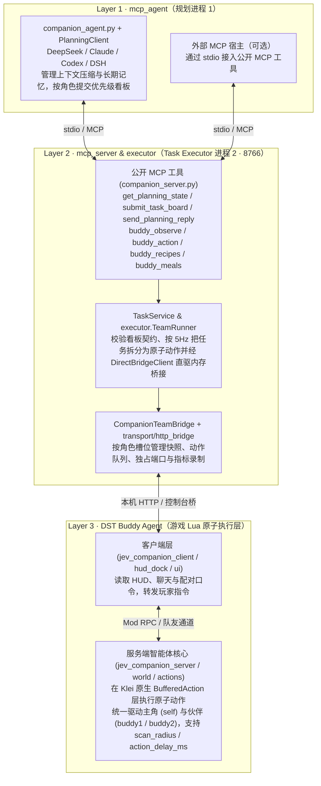

# 系统架构

项目采用严格的**三层单向分层架构**（`mcp_agent` 与 `mcp_server` 互不 import；`executor/` 只向下依赖 `common/` 与 `transport/`）：
1. **规划层（`python/mcp_agent` / 外部 MCP 宿主）**：只负责高层决策、记忆与上下文压缩，通过公开 MCP 工具提交优先级任务看板，不运行实时执行循环。
2. **任务拆分与执行层（`python/mcp_server` + `python/executor`）**：作为确定性的 **Task Executor**，按 5Hz 将看板拆解为原子动作队列（通过 `DirectBridgeClient` 直接操作内存中的 `CompanionTeamBridge`，无内部 MCP 绕行），对外仅向规划方暴露 MCP 工具。
3. **原子执行层（`mods/dst_buddy_agent`）**：在 Klei 原生 `BufferedAction` 层校验并执行单个原子动作，受 `scan_radius` / `action_delay_ms` 约束并回传快照与回执。

## 一次内置指令

1. 玩家在游戏右侧 HUD 开启主角托管（`/buddy self`）或召唤伙伴（`/buddy summon 小威`），并在游戏内切换模式或发送 `@自己` / `@名字` / `@全体` 指令。
2. `companion_agent.py` 中的 `PlanningClient` 读取各激活成员的实时观测、记忆索引与重规划原因，调用 `CompanionPlanner` 或外部 CLI 生成优先级任务看板，通过 `submit_task_board` 提交给服务端进程。
3. 进程 2 中的 `TaskService` 校验契约并交由 `executor.TeamRunner` / `CompanionTasks` / `PriorityBoardExecutor` 5Hz 确定性拆解为原子动作，直接写入 `CompanionTeamBridge`；Lua `jev_companion_actions` 在 Klei 原生 `BufferedAction` 层执行（含四季求生、医疗、战斗、烹饪、建造等）。
4. 动作回执返回后由 `TeamRunner` 刷新看板进度；如触发极端冻伤/过热/淋湿告警或返程风险则通过 `planning_state` 主动唤醒规划端重规划，并在完成或异常时通过 `buddy_reply` 在游戏内简短汇报。

## 架构决策：统一服务端智能体核心（`self` + `buddy1` + `buddy2`）与可配置仿真约束

为避免每套新功能（战斗、多菜谱烹饪、医疗包扎、四季换季生存）在客户端与服务端各自重复维护两套 Lua 执行层，项目自 `DST Buddy Agent 0.9.0` 起全面收敛为**统一服务端智能体核心**：

- **单模组统一双形态**：`DST Buddy Agent`（[mods/dst_buddy_agent](../mods/dst_buddy_agent)）同时承载**主角托管（`self` 槽位，`/buddy self`、`@自己` 或 HUD「托管自己」按钮）**与**最多 2 名 AI 威尔逊伙伴（`buddy1` / `buddy2`）**。三者共用同一套服务端 `BufferedAction` 执行与状态机，共享营地记忆并由同一个 Python MCP / 规划协同层调度，一次更新即可同时赋予主角托管与 AI 伙伴新能力。
- **保留纯本地视野边界 + 可配置仿真延迟（Benchmark 兼容性）**：
  - 服务端严格通过本地实体扫描半径 `scan_radius`（Mod 配置项：`10 / 15 / 20`，默认 `20`）感知周边世界与敌人，禁止读取未探索地形或全图坐标。
  - 提供 Mod 配置项 `action_delay_ms`（`0 / 100 / 200 / 350` ms，默认 `0`），用于在服务端主动注入动作执行延迟，可在单机/无头服务端复现客户端网络往返延迟约束，用于智能体评测与消融实验。
- **历史纯客户端基线完全解耦归档（[`archive/`](../archive/README.md)）**：原纯客户端 Mod `dst_player_agent` 及单人客户端专属组件已重命名为 `player_bridge.py` / `player_server.py` / `player_agent.py` / `player_probe.py` / `player_planner.py` 并冻结于自包含目录 `archive/`，与主线 `python/` 之间零双向 import（主线 HTTP 传输基础设施独立于 `python/transport/`，确定性 Task Executor 独立于 `python/executor/`）；当前主线通过 [headless_sandbox.py](../python/tools/headless_sandbox.py)（Klei 官方 `nullrenderer`，单场景严格重置隔离）自动化运行 13 场景真机 E2E 回归。
