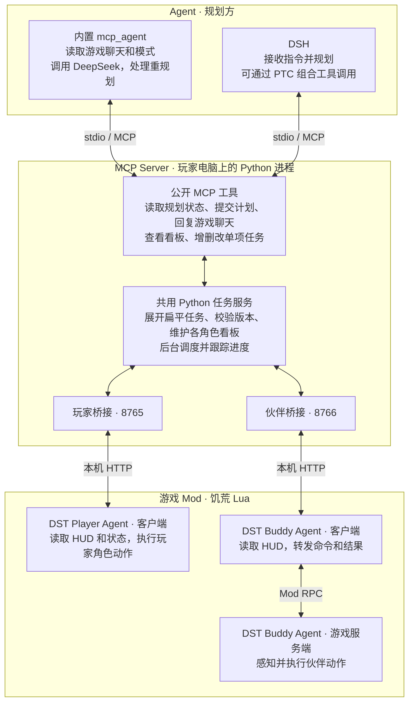

# 系统架构

玩家版和伙伴版各自启动一个 MCP 服务进程，共用任务服务的实现。图中的两个桥接节点表示两种部署入口。每个受控角色维护自己的看板和任务进度。伙伴版只召唤一人时也使用队伍协议。

## 一次内置指令

1. 玩家在游戏 UI 切换模式或在聊天框发送指令。Lua 将控制状态和游戏快照发给本机 MCP Server。
2. `mcp_agent` 调用 `get_planning_state`，读取指令、看板、复核原因和版本，再交给 DeepSeek 规划。
3. Agent 调用 `submit_task_board` 并携带读取到的版本。MCP Server 校验、更新看板，并持续调度。Lua 接收并执行具体动作。
4. Agent 读取最新进度，通过 `send_planning_reply` 在游戏里回复。自主模式继续规划阶段目标，指令模式确认完成后等待下一条指令。

DSH 使用同一套 MCP 工具，也可用 `submit_task` 新增单项任务。游戏动作和看板工具详见 [MCP 接口](MCP.md)。

## 架构决策：统一服务端智能体核心（`self` + `buddy1` + `buddy2`）与可配置仿真约束

为避免一套新功能（战斗、多菜谱烹饪、后续季节生存/农耕）在客户端与服务端各自重复维护两套 Lua 执行层，项目从 `DST Buddy Agent 0.9.0` 起采用**统一服务端智能体核心**：

- **单模组统一双形态**：`DST Buddy Agent`（服务端 Mod）同时承载**主角托管（`self` 槽位，`/buddy self`、`@自己` 或 HUD「托管自己」按钮）**与**最多 2 名 AI 威尔逊伙伴（`buddy1` / `buddy2`）**。三者共用同一套服务端 `BufferedAction` 执行与状态机，共享营地记忆并由同一个 Python MCP / 规划协同层调度，一次创意工坊更新即可同时赋予主角托管与 AI 伙伴新能力。
- **保留纯本地视野边界 + 可配置仿真延迟（Benchmark 兼容性）**：
  - 服务端严格通过本地实体扫描半径 `scan_radius`（Mod 配置项：`10 / 15 / 20`，默认 `20`）感知周边世界与敌人，禁止读取未探索地形或全图坐标。
  - 提供 Mod 配置项 `action_delay_ms`（`0 / 100 / 200 / 350` ms，默认 `0`），用于在服务端主动注入动作执行延迟，可在单机/无头服务端复现客户端网络往返延迟约束，用于智能体评测与消融实验。
- **历史纯客户端基线冻结**：`mods/dst_player_agent` 冻结保留为纯客户端（免服务端 Mod 入房、客户端 `playercontroller` + `SendRPCToServer` 链路）历史评测基线，配合 `python/tools/client_e2e_sandbox.py` 可随时复现 6 场景小窗真客户端 E2E；新增玩法与功能统一在 `mods/dst_buddy_agent` 上高速迭代，并通过 `python/tools/headless_sandbox.py`（Klei 官方 `nullrenderer`）跑 9 场景全自动无头真引擎回归。
